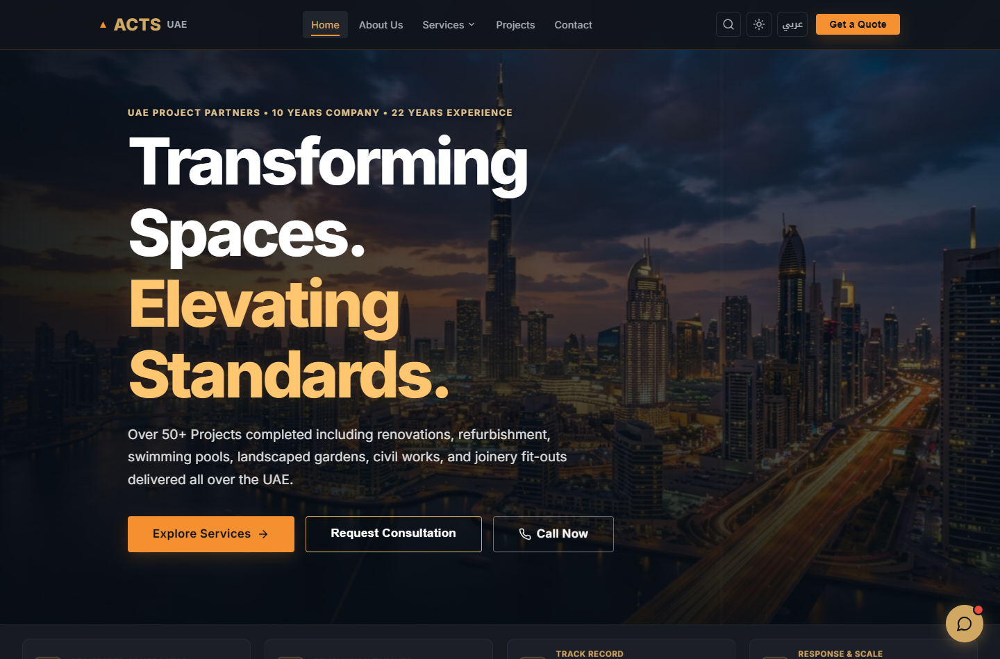
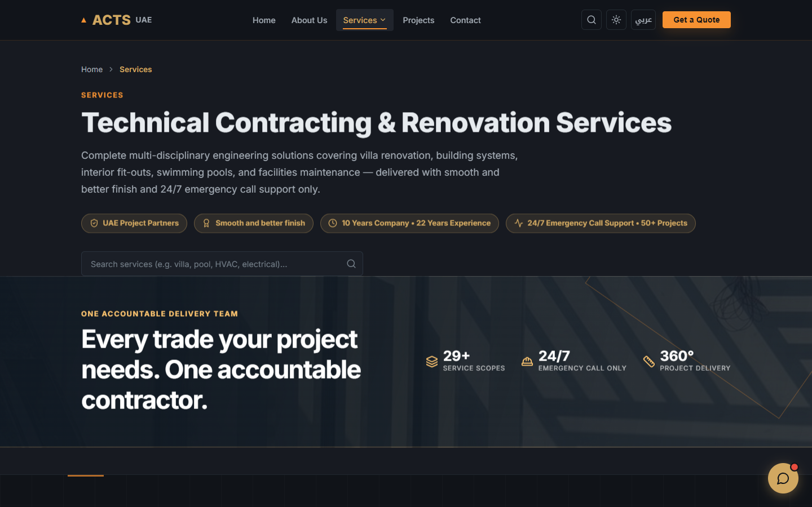
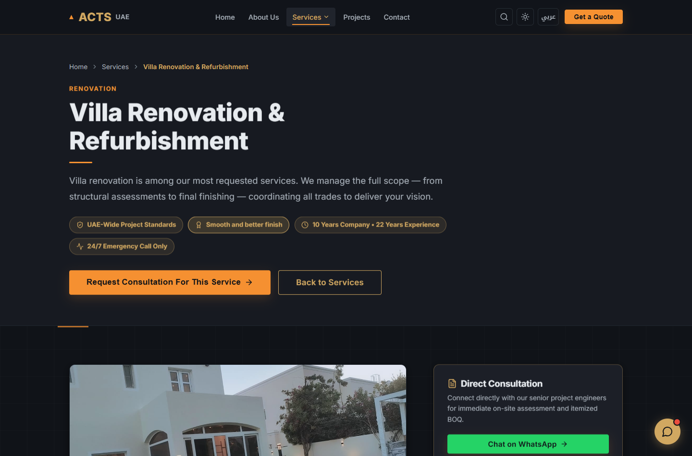
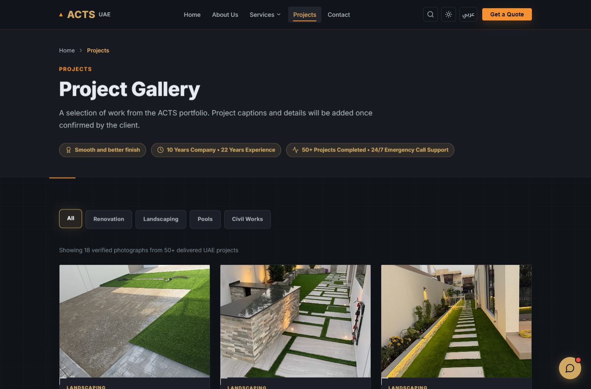
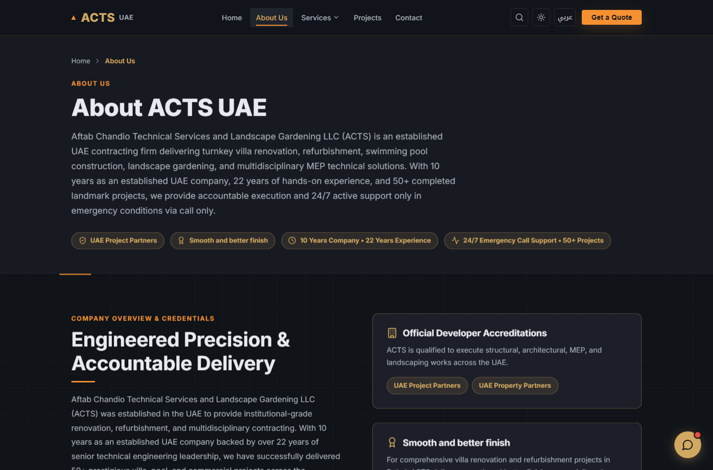
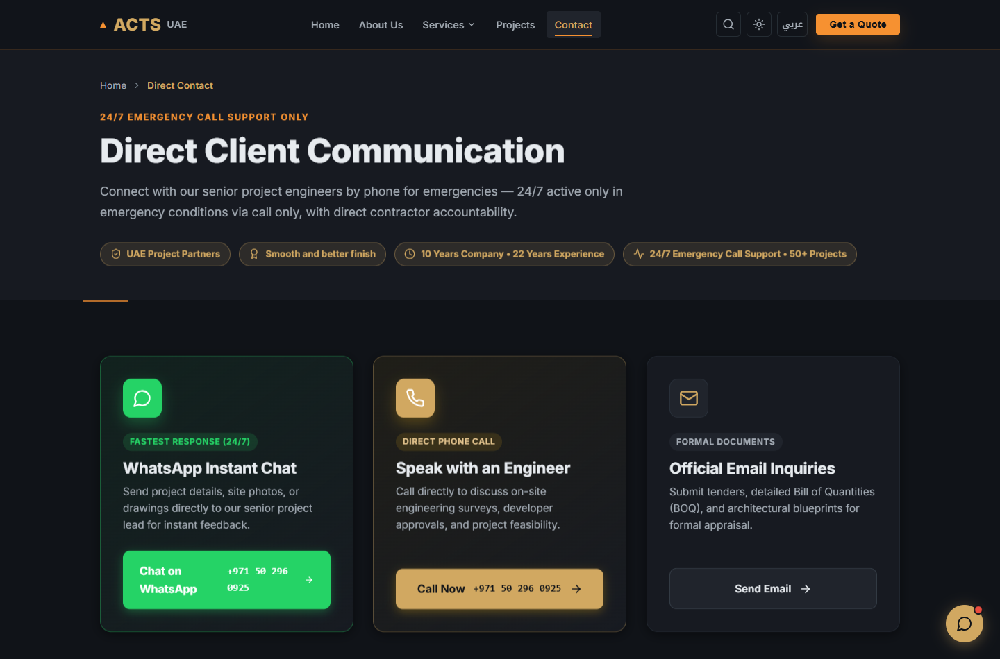
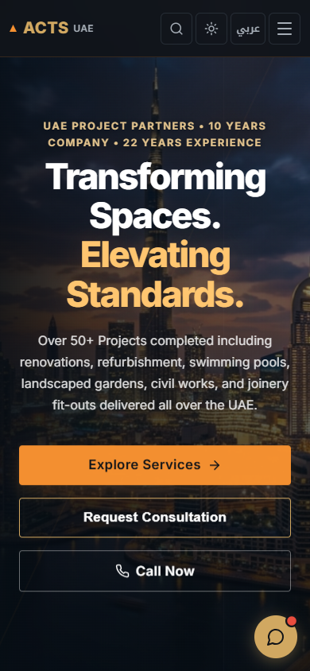
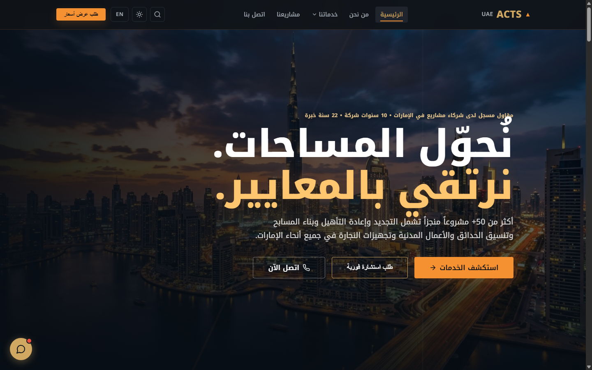

# ACTS UAE — House Renovation & Technical Services

<div align="center">



[](https://react.dev/)
[](https://www.typescriptlang.org/)
[](https://vitejs.dev/)
[-f59e0b?style=for-the-badge)](https://react.i18next.com/)
[](#license)

**A high-performance, bilingual web platform for ACTS (Aftab Chandio Technical Services & Landscape Gardening LLC) — premier UAE contractor delivering turnkey villa renovation, refurbishment, MEP engineering, swimming pools, landscaping, and technical fit-out solutions.**

[Explore Live Demo](http://localhost:5173/) • [Key Features](#-key-features) • [Screenshots](#-screenshots) • [Getting Started](#-getting-started) • [Tech Stack](#-technology-stack)

</div>

---

## 📖 Table of Contents

- [Overview](#-overview)
- [Key Features](#-key-features)
- [Screenshots Showcase](#-screenshots)
- [Technology Stack](#-technology-stack)
- [Project Architecture](#-project-architecture)
- [Getting Started](#-getting-started)
- [Available Scripts](#-available-scripts)
- [SEO & Production Optimizations](#-seo--production-optimizations)
- [One-Click Utility Scripts](#-one-click-utility-scripts)
- [License](#-license)

---

## 🌟 Overview

**ACTS UAE** is an established technical contracting and renovation firm backed by **10 years of corporate operations**, **22 years of senior engineering leadership**, and **50+ completed landmark projects** across the United Arab Emirates. 

This repository contains the complete frontend web application featuring a bespoke design system, seamless internationalization (English & Arabic RTL), comprehensive service cataloging, interactive project portfolios, instant lead generation flows, and an automated SEO engine.

---

## 🚀 Key Features

### 🌐 Native Bilingual & RTL Support
- Instant language toggle between **English** and **Arabic** (`ar`).
- Full bidirectional layout engine (`dir="rtl"` / `dir="ltr"`), handling alignment, margins, icons, and typography.
- Persistent language preference saved across sessions via local storage.

### 🎨 High-End Modern Aesthetic & Design Tokens
- Crafted with custom CSS variables, elegant dark mode palette with warm amber/gold accents (`#f59e0b`, `#d97706`).
- Subtle micro-interactions, smooth scroll reveal system, elevated glassmorphic cards, and hover states.
- Fully responsive across desktop, laptop, tablet, and mobile form factors.

### 🛠️ 29+ Comprehensive Technical Service Pages
- Dedicated service directory and dynamic routing (`/services/:slug`) covering:
  - **Villa Renovation & Turnkey Refurbishment**
  - **MEP & Building Systems** (Electrical, Plumbing, HVAC, Mechanical, Home Automation, Solar)
  - **Outdoor & Structural** (Swimming Pools, Landscaping, Parking Sheds, Fencing)
  - **Civil & Interior Fit-Out** (Tiling, Painting, Carpentry, Kitchen Joinery, Gypsum Partitions, Epoxy Flooring)
  - **Specialist & Maintenance** (Acoustic Panels, Pest Control, Annual Maintenance Contracts)

### 🖼️ Interactive Project Gallery
- Filterable showcase of completed UAE projects organized into categories (*Renovation*, *Landscaping*, *Pools*, *Civil Works*).
- High-resolution verified project photography and fast client inquiry integration.

### 💬 Instant Lead Generation & Concierge Assistant
- Floating AI chatbot concierge assisting clients with inquiries and quote estimates.
- One-tap WhatsApp chat integration (`+971 50 296 0925`).
- Direct engineer hotline call links and formal RFQ inquiry form.

### ⚡ Built-in SEO & Performance Automation
- Dynamic meta tags, OpenGraph cards, and Twitter cards per route via `SEOHead` component.
- Prebuild automated sitemap generator (`scripts/generate-seo-files.mjs`).
- Fast Vite bundling with zero unnecessary runtime bloat.

---

## 📸 Screenshots

### Desktop Views

| 01. Homepage Hero | 02. Comprehensive Services Catalog |
| :---: | :---: |
|  |  |

| 03. Service Detail View | 04. Filterable Project Gallery |
| :---: | :---: |
|  |  |

| 05. About ACTS UAE | 06. Direct Client Communication |
| :---: | :---: |
|  |  |

### Multilingual & Mobile

| 07. Mobile Responsive Experience (iPhone Viewport) | 08. Arabic RTL Native Interface |
| :---: | :---: |
|  |  |

---

## 💻 Technology Stack

| Layer | Technology | Details |
| :--- | :--- | :--- |
| **Framework** | [React 18.3](https://react.dev/) | Modern functional components and hooks |
| **Language** | [TypeScript 5.7](https://www.typescriptlang.org/) | Type-safe development with strict type checking |
| **Build Tool** | [Vite 6.0](https://vitejs.dev/) | Ultra-fast HMR and optimized production bundling |
| **Routing** | [React Router 6.28](https://reactrouter.com/) | Client-side routing with automatic scroll-to-top |
| **Internationalization** | [i18next](https://www.i18next.com/) & [react-i18next](https://react.i18next.com/) | Bilingual English & Arabic dictionary system |
| **Icons** | [Lucide React](https://lucide.dev/) | Modern, lightweight SVG iconography |
| **Styling** | Vanilla CSS3 | Custom design system, CSS variables, and layout tokens |

---

## 📁 Project Architecture

```text
acts-house-renovation/
├── public/                     # Static public assets
│   ├── favicon.ico
│   ├── robots.txt              # Crawler directives
│   └── sitemap.xml             # Generated sitemap
├── screenshots/                # Visual documentation screenshots
│   ├── 01_homepage.png
│   ├── 02_services.png
│   ├── 03_service_detail.png
│   ├── 04_projects.png
│   ├── 05_about.png
│   ├── 06_contact.png
│   ├── 07_mobile_responsive.png
│   └── 08_arabic_rtl.png
├── scripts/                    # Automation scripts
│   └── generate-seo-files.mjs  # Prebuild script generating sitemaps & SEO data
├── src/
│   ├── components/             # Reusable UI & layout components
│   │   ├── chatbot/            # Concierge chat widget
│   │   ├── layout/             # Navbar, Footer, Layout wrapper
│   │   └── ui/                 # SEOHead, Breadcrumbs, ScrollRevealManager
│   ├── config/                 # Site configuration and metadata
│   ├── data/                   # Services catalog, categories, and project data
│   ├── hooks/                  # Custom React hooks (theme, scroll detection)
│   ├── i18n/                   # Localization setup & locale files
│   │   └── locales/            # en.ts and ar.ts dictionaries
│   ├── pages/                  # Route views
│   │   ├── Home.tsx            # Main landing page
│   │   ├── About.tsx           # Company background & credentials
│   │   ├── Services.tsx        # All services catalog
│   │   ├── ServiceDetail.tsx   # Dynamic service page
│   │   ├── Projects.tsx        # Verified project gallery
│   │   ├── Contact.tsx         # Communication & quote request
│   │   └── NotFound.tsx        # 404 error page
│   ├── utils/                  # Search indexing and formatting helpers
│   ├── App.tsx                 # App component with route declarations
│   ├── index.css               # Global design tokens and styling
│   └── main.tsx                # Entry point
├── index.html                  # HTML template
├── package.json                # Project dependencies and scripts
├── tsconfig.json               # TypeScript compiler config
├── vite.config.ts              # Vite configuration
└── sync-project.bat            # Automated git synchronization script
```

---

## 🛠️ Getting Started

### Prerequisites

Ensure you have the following installed:
- [Node.js](https://nodejs.org/) (version `18.x` or higher recommended)
- `npm` or `pnpm`

### Installation

1. **Clone the repository**:
   ```bash
   git clone https://github.com/sayeemraza234/ACTS-House-Renovation.git
   cd ACTS-House-Renovation
   ```

2. **Install dependencies**:
   ```bash
   npm install
   ```

3. **Start the local development server**:
   ```bash
   npm run dev
   ```

4. **Open in browser**:
   Navigate to [http://localhost:5173](http://localhost:5173) to view the application.

---

## 📜 Available Scripts

| Script | Command | Description |
| :--- | :--- | :--- |
| **Development** | `npm run dev` | Starts Vite dev server with Hot Module Replacement (HMR) |
| **Type Check** | `npm run type-check` | Runs TypeScript compiler to validate all types without emitting code |
| **Build** | `npm run build` | Runs prebuild SEO generation, validates types, and builds for production |
| **Preview** | `npm run preview` | Starts a local server to preview the production build output |
| **Lint** | `npm run lint` | Runs ESLint to verify code quality and style standards |

---

## 🔍 SEO & Production Optimizations

- **Prebuild Automation**: Running `npm run build` executes `node scripts/generate-seo-files.mjs` first, dynamically updating `public/sitemap.xml` with current dates and all 29+ service route paths.
- **Canonical URLs & OpenGraph**: All pages inject canonical URLs, descriptions, keywords, and title tags tailored for Google search rankings and social media previews.
- **Production Asset Bundling**: Vite splits chunks, minifies CSS, optimizes JS, and bundles static assets for sub-second load times.

---

## ⚙️ One-Click Utility Scripts

For Windows developers, a handy batch script is provided in the root directory:
- `sync-project.bat`: Safe automated helper for staging, committing, and synchronizing with remote repositories.

---

## 📄 License

Proprietary — All rights reserved by **Aftab Chandio Technical Services & Landscape Gardening LLC (ACTS)**. Unauthorized distribution or copying is strictly prohibited.
